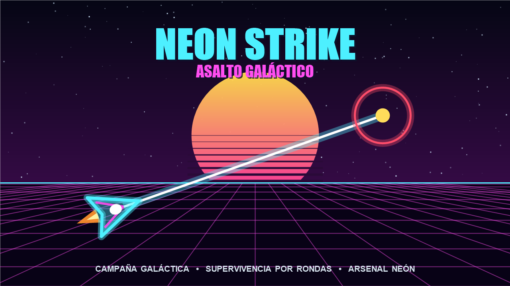
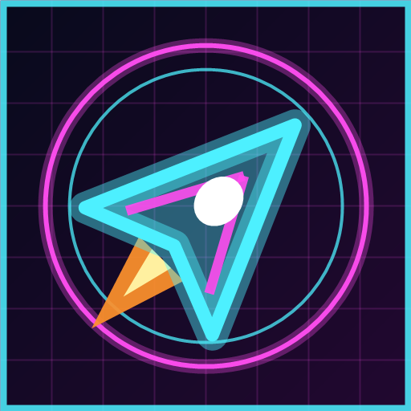

# 🚀 Neon Strike: Asalto Galáctico

<p align="center">
  
</p>

<p align="center">
  
</p>

**Neon Strike: Asalto Galáctico** es un **Shooter 2D Twin-Stick** de estética **Synthwave / Neón** desarrollado íntegramente en **Godot Engine 4.3**. Combina una **Campaña Galáctica de 9 sectores** y un **Modo Supervivencia por Rondas Infinitas** con progresión *Roguelite* mediante cartas tácticas, tienda permanente en el hangar, gráficos vectoriales procedurales, sintetizador de audio y música *chiptune* en tiempo real, soporte multiplataforma (**PC Windows x86_64** y **Android APK** con controles táctiles *Twin-Stick*) y arquitectura de guardado cifrada (**AES-256 + HMAC-SHA256**).

---

## 📋 Tabla de Contenidos

1. [Características Principales](#-características-principales)
2. [Modos de Juego](#-modos-de-juego)
   - [Campaña Galáctica (9 Sectores)](#1-campaña-galáctica-9-sectores)
   - [Supervivencia por Rondas Infinitas](#2-supervivencia-por-rondas-infinitas)
3. [Menús y Sistemas de Progresión](#-menús-y-sistemas-de-progresión)
4. [Arsenal de Armas (6 Armas)](#-arsenal-de-armas-6-armas)
5. [Mejoras Permanentes del Hangar (8 Sistemas)](#-mejoras-permanentes-del-hangar-8-sistemas)
6. [Cartas Tácticas Roguelite (16 Módulos)](#-cartas-tácticas-roguelite-16-módulos)
7. [Bestiario: Enemigos y Jefes Multifase](#-bestiario-enemigos-y-jefes-multifase)
8. [Potenciadores, Botín y Logros](#-potenciadores-botín-y-logros)
9. [Controles (PC, Mando y Android Táctil)](#-controles-pc-mando-y-android-táctil)
10. [Instalación y Ejecución (PC, APK y Código Fuente)](#-instalación-y-ejecución)
11. [Arquitectura del Proyecto y Seguridad](#-arquitectura-del-proyecto-y-seguridad)

---

## ✨ Características Principales

- **Gráficos Vectoriales Neón 100% Procedurales**: Naves, proyectiles, rayos láser, portales de aparición, explosiones de partículas, ondas expansivas, nebulosas dinámicas y paisaje *synthwave* en perspectiva renderizados en tiempo real.
- **Sintetizador de Audio y Música Chiptune Integrado**: Motor de audio procedural (`scripts/autoload/sfx.gd`) que sintetiza en memoria **25 efectos de sonido** y **3 pistas musicales completas** (*Menú*, *Combate* y *Jefe*) en un hilo secundario sin depender de archivos `.wav` o `.ogg` externos.
- **2 Modos de Juego Completos**: Campaña estructurada en **9 sectores** con calificación de 1 a 3 estrellas y **3 jefes finales multifase**, más **Modo Supervivencia por Rondas** infinito con tabla de récords local Top 10.
- **4 Niveles de Dificultad**:
  - 🟢 **Recluta**: Vida enemiga `x0.7` | Daño enemigo `x0.6` | Puntos `x0.7` | Créditos `x0.8`
  - 🔵 **Soldado**: Vida enemiga `x1.0` | Daño enemigo `x1.0` | Puntos `x1.0` | Créditos `x1.0`
  - 🟠 **Veterano**: Vida enemiga `x1.4` | Daño enemigo `x1.4` | Puntos `x1.5` | Créditos `x1.3`
  - 🔴 **Pesadilla**: Vida enemiga `x1.9` | Daño enemigo `x2.0` | Puntos `x2.2` | Créditos `x1.8`
- **Multiplataforma Real (PC + Android)**:
  - Ejecutable autocontenido para Windows (`build/windows/NeonStrike.exe`) con `.pck` e icono nativo `.ico` incrustados.
  - Paquete instalable para Android (`build/android/NeonStrike.apk`) firmado con **APK Signature Scheme v1/v2/v3**, icono adaptativo y controles táctiles virtuales automáticos.
- **Seguridad e Integridad de Datos**: Guardado cifrado con **AES-256**, firmado con **HMAC-SHA256** contra manipulación externa y validación estricta de rangos y entradas.

---

## 🎮 Modos de Juego

### 1. Campaña Galáctica (9 Sectores)

Avanza a través de 9 sectores espaciales desbloqueando armas, obteniendo créditos y consiguiendo hasta **3 estrellas** por misión (según la integridad de tu casco al finalizar):

| Sector | Nombre | Oleadas | Hostiles Detectados | Jefe de Sector | Recompensa | Desbloquea |
| :---: | :--- | :---: | :--- | :---: | :---: | :---: |
| **01** | **Frontera Neón** | 4 | Dron, Artillero | — | `+250 CR` | Escopeta Iónica |
| **02** | **Cinturón de Asteroides** | 5 | Dron, Artillero, Kamikaze | — | `+300 CR` | — |
| **03** | **Fortaleza Coloso** | 3 | Dron, Artillero, Kamikaze | **Coloso de Hierro** | `+600 CR` | Ametralladora |
| **04** | **Nebulosa Carmesí** | 5 | Dron, Artillero, Kamikaze, Tanque | — | `+400 CR` | — |
| **05** | **Estación Fantasma** | 5 | Dron, Artillero, Tanque, Divisor | — | `+450 CR` | Cañón de Plasma |
| **06** | **Nido del Enjambre** | 3 | Dron, Kamikaze, Divisor, Artillero | **Reina del Enjambre** | `+900 CR` | Lanzacohetes |
| **07** | **Tormenta de Plasma** | 5 | Artillero, Francotirador, Kamikaze, Tanque | — | `+550 CR` | — |
| **08** | **Puerta Omega** | 6 | Todos los arquetipos | — | `+650 CR` | Railgun |
| **09** | **Núcleo Omega** | 3 | Todos los arquetipos | **Núcleo Omega** | `+1500 CR` | Victoria de Campaña |

### 2. Supervivencia por Rondas Infinitas

- Las rondas escalan progresivamente en presupuesto de aparición, tipos de hostiles y estadísticas enemigas.
- **Al finalizar cada ronda**, se despliega el selector de **Mejora Táctica de Combate** para instalar **1 de 3 Cartas Roguelite** aleatorias en tu nave.
- **Cada 3 rondas**, recibes una cápsula de suministro de munición que además desbloquea temporalmente un arma adicional durante la partida si aún no la habías adquirido en el hangar.
- **Cada 5 rondas**, irrumpe un Jefe Multifase (**Ronda 5**: *Coloso de Hierro*, **Ronda 10**: *Reina del Enjambre*, **Ronda 15**: *Núcleo Omega*, y ciclos escalados en rondas posteriores).

---

## 🖥️ Menús y Sistemas de Progresión

1. **Menú Principal (`scenes/main_menu.tscn`)**:
   - Barra superior de estado con nombre del piloto, selector rápido de dificultad, contador de logros y saldo de créditos (`CR`).
   - Tarjeta de **Estado de la Flota** con resumen de sectores, estrellas obtenidas, armas desbloqueadas, mejor ronda y bajas totales.
2. **Selector de Sector (Campaña)**:
   - Cuadrícula 3x3 con indicador de bloqueo, etiqueta `[JEFE]`, calificación de estrellas y panel lateral de **Informe de Misión** con descripción narrativa, amenazas, recompensas y récord de puntos.
3. **Hangar y Arsenal**:
   - **Mejoras de la Nave**: 8 sistemas actualizables con barras de nivel y coste escalonado en créditos.
   - **Arsenal de Armas**: Compra y desbloqueo permanente de las 6 armas con ficha técnica de daño, cadencia y munición.
4. **Récords, Estadísticas y Logros**:
   - Tabla **Top Supervivencia** con nombre de piloto, dificultad, ronda alcanzada y puntuación.
   - **Estadísticas Globales**: Hostiles destruidos, jefes derrotados, misiones jugadas, mejor ronda y tiempo total de combate.
   - **Catálogo de 12 Logros** con estado de desbloqueo y botón para reiniciar progreso.
5. **Manual de Combate y Opciones**:
   - Guía detallada de controles y mecánicas tácticas.
   - Panel de **Opciones** (reutilizable también desde la pausa en combate): Nombre del piloto, Volumen General, Música, Efectos de Sonido, Pantalla Completa, Vibración de Pantalla, Números de Daño Flotantes y Contador de FPS.
6. **HUD de Combate y Pausa**:
   - Barras de Vida y Escudo, indicadores de Bombas EMP, estado de enfriamiento del Dash y potenciadores activos.
   - Barra superior de progreso de oleada/ronda y barra especial de **Jefe** con indicador de fase.
   - Marcador de puntos, **Multiplicador de Combo (`x1` a `x8`)** y créditos recolectados.
   - Barra rápida inferior para las **6 armas** (`[1]` a `[6]`) con munición en tiempo real y **Mini-Radar Táctico** en la esquina inferior derecha.

---

## 🔫 Arsenal de Armas (6 Armas)

| Tecla | Arma | Daño | Cadencia | Munición | Coste Hangar | Características Especiales |
| :---: | :--- | :---: | :---: | :---: | :---: | :--- |
| `1` | **Bláster** | `11` | `6.7 /s` | Infinita | Inicial (`0 CR`) | Arma de energía equilibrada y confiable. |
| `2` | **Escopeta Iónica** | `9 x 7` | `1.7 /s` | `36` | `350 CR` | Dispara un abanico devastador de 7 perdigones a corta distancia. |
| `3` | **Ametralladora** | `6.5` | `18.2 /s` | `260` | `600 CR` | Cadencia extrema ideal para barrer enjambres. |
| `4` | **Cañón de Plasma** | `30` | `2.6 /s` | `45` | `1000 CR` | Esferas de alta energía que **atraviesan hasta 6 enemigos**. |
| `5` | **Lanzacohetes** | `45` | `1.3 /s` | `18` | `1500 CR` | Misiles **teledirigidos** con explosión de daño en área (`120 px`). |
| `6` | **Railgun** | `85` | `1.1 /s` | `20` | `2200 CR` | Haz electromagnético instantáneo que perfora toda la línea de tiro. |

---

## 🛠️ Mejoras Permanentes del Hangar (8 Sistemas)

| Mejora | Niveles Máx. | Coste Base | Efecto por Nivel |
| :--- | :---: | :---: | :--- |
| **Blindaje Reforzado** | `5` | `150 CR` | `+20` de vida máxima para el casco. |
| **Núcleo de Potencia** | `5` | `200 CR` | `+10%` de daño con todas las armas. |
| **Sistema de Enfriamiento** | `5` | `200 CR` | `+8%` de cadencia de disparo. |
| **Propulsores** | `5` | `150 CR` | `+6%` de velocidad de movimiento. |
| **Generador de Escudo** | `5` | `250 CR` | `+15` de escudo regenerable (se recarga tras 3.5s sin recibir daño). |
| **Imán de Recolección** | `3` | `120 CR` | `+35%` de radio de atracción magnética de créditos y botín. |
| **Arsenal de Bombas** | `3` | `300 CR` | `+1` Bomba EMP adicional al iniciar cada misión. |
| **Impulso Cuántico** | `3` | `180 CR` | `-12%` de tiempo de enfriamiento del Dash Cuántico. |

---

## 🃏 Cartas Tácticas Roguelite (16 Módulos)

Durante la partida, al superar rondas (en Supervivencia) o cada 2 oleadas (en Campaña), puedes instalar **1 de 3 módulos tácticos** acumulables:

- **Munición Pesada (`DMG`)**: `+20%` de daño.
- **Gatillo Rápido (`RPM`)**: `+15%` de cadencia de disparo.
- **Disparo Múltiple (`x+1`)**: `+1` proyectil adicional en cada disparo de cualquier arma.
- **Perforación (`>>`)**: Los proyectiles atraviesan `+1` enemigo adicional.
- **Casco Reforzado (`HP+`)**: `+25` de vida máxima y repara `25` puntos.
- **Nanobots (`+`)**: Repara el `100%` de la vida y recarga todo el escudo.
- **Turbo (`SPD`)**: `+10%` de velocidad de movimiento.
- **Barrera (`SH`)**: `+25` de escudo máximo regenerable.
- **Ojo de Halcón (`CRT`)**: `+10%` de probabilidad de impacto crítico (daño `x2`).
- **Robo Vital (`VMP`)**: Cada enemigo eliminado regenera `+2` puntos de vida.
- **Bomba Extra (`B`)**: `+1` Bomba EMP de inmediato.
- **Atractor (`MAG`)**: `+50%` de radio de recogida de objetos.
- **Dash Explosivo (`DSH`)**: Al usar el Dash liberas una onda expansiva que daña a los enemigos cercanos.
- **Aceleradores (`VEL`)**: `+20%` de velocidad y alcance de proyectiles.
- **Coraza de Púas (`SPK`)**: Cualquier enemigo que colisione contigo recibe `30` de daño reflejado.
- **Reactor Cuántico (`CD`)**: `-25%` de enfriamiento del Dash.

---

## 👾 Bestiario: Enemigos y Jefes Multifase

### Enemigos Comunes
1. **Dron**: Caza ligero y veloz que zigzaguea hacia tu posición.
2. **Artillero**: Mantiene distancia media orbitando a tu alrededor mientras dispara proyectiles dirigidos.
3. **Kamikaze**: Acelera bruscamente al acercarse y detona al contacto.
4. **Tanque**: Hexágono blindado de alta resistencia que dispara abanicos de 5 proyectiles.
5. **Divisor**: Octágono cristalino con disparo doble que **se divide en 2 Mini-drones** al ser destruido.
6. **Francotirador**: Apunta con una **mira láser visible** durante `1.05s` antes de disparar un proyectil de alta velocidad.
7. **Mini-dron**: Fragmento ultrarrápido engendrado por Divisores o por la Reina del Enjambre.

### Jefes Multifase (Entran en Fase 2 al bajar del 50% de vida)
- **Coloso de Hierro (Sector 3 / Ronda 5)**: Acorazado pesado que alterna ráfagas dobles de ametralladora, anillos radiales de 14-18 proyectiles y embestidas de alta velocidad.
- **Reina del Enjambre (Sector 6 / Ronda 10)**: Entidad biomecánica que dispara espirales de bio-plasma, invoca escuadrones de Kamikazes y Mini-drones y lanza abanicos ácidos.
- **Núcleo Omega (Sector 9 / Ronda 15)**: Fortaleza final con cortinas de doble hélice, anillos concéntricos con lanzas dirigidas y el devastador **Rayo Láser Omega giratorio**.

---

## 🏆 Potenciadores, Botín y Logros

- **Botín en Combate**:
  - 💰 **Créditos (`+CR`)**: Moneda para comprar armas y mejoras permanentes en el Hangar.
  - 💚 **Botiquín (`+30 VIDA`)**: Repara el casco de inmediato.
  - 💠 **Caja de Munición (`+MUNICIÓN`)**: Recarga el `45%` de todas las armas (y entrega un arma temporal en Supervivencia).
  - 🟣 **Núcleo EMP (`+1 BOMBA`)**: Añade una Bomba EMP que destruye todos los proyectiles enemigos en pantalla e inflige daño masivo.
  - 🟠 **Potenciador Temporal (10 segundos)**: Otorga aleatoriamente **Sobrecarga** (`+65%` cadencia), **Daño x2**, **Escudo +50**, **Hipervelocidad** (`+35%` velocidad) o **Invencible**.
- **12 Logros Desbloqueables**:
  - *Primera Sangre*, *Exterminador* (1000 bajas), *Rompehierros*, *Matarreinas*, *Salvador de la Galaxia*, *Superviviente* (Ronda 10), *Inmortal* (Ronda 25), *Imparable* (Combo x8), *Intocable* (Sector sin recibir daño), *Magnate* (5000 CR), *Arsenal Completo* y *Pesadilla Viviente*.

---

## 🎮 Controles (PC, Mando y Android Táctil)

| Acción | Teclado y Ratón (PC) | Mando / Gamepad | Android (Pantalla Táctil) |
| :--- | :--- | :--- | :--- |
| **Mover nave** | `W`, `A`, `S`, `D` o `Flechas` | Stick Izquierdo | **Joystick Virtual Izquierdo** |
| **Apuntar** | Cursor del Ratón | — | **Joystick Virtual Derecho (360°)** |
| **Disparar** | `Clic Izquierdo` | Gatillo `RT` | **Mantener Joystick Derecho** |
| **Dash Cuántico (Invulnerable)** | `Espacio` o `Shift` | Botón `A` | **Botón Táctil `DASH`** |
| **Detonar Bomba EMP** | `F` o `Clic Derecho` | Botón `Y` | **Botón Táctil `BOMBA EMP`** |
| **Cambiar de arma** | Teclas `1` a `6`, `Q`/`E`, Rueda | `LB` / `RB` | **Tocar casilla `[1]`-`[6]` en el HUD** |
| **Pausar partida** | `ESC` o `P` | Botón `Start` | Botón Atrás / Pausa |

---

## 📦 Instalación y Ejecución

### Opción 1: Ejecutar directamente en PC (Windows 64-bit)
No requiere instalar Godot. Ejecuta directamente el binario compilado:
```text
build/windows/NeonStrike.exe
```

### Opción 2: Instalar en Android (APK)
Transfiere el paquete firmado a tu dispositivo Android e instálalo:
```text
build/android/NeonStrike.apk
```

### Opción 3: Abrir o Modificar desde el Código Fuente en Godot 4.3+
1. Abre **Godot Engine 4.3** (o superior).
2. Haz clic en **Importar** y selecciona el archivo `project.godot` en la raíz del repositorio.
3. Presiona **F5** para ejecutar el juego desde el editor, o ve a **Proyecto -> Exportar** para generar nuevos binarios con los perfiles preconfigurados (`Windows Desktop` y `Android`).

---

## 🔒 Arquitectura del Proyecto y Seguridad

```text
├── assets/
│   ├── icon.png              # Icono principal 512x512
│   ├── icon.ico              # Icono nativo Windows multi-resolución (256px a 16px)
│   ├── icon_fg.png           # Capa frontal de icono adaptativo Android
│   ├── icon_bg.png           # Capa de fondo de icono adaptativo Android
│   ├── splash.png            # Pantalla de arranque (Boot Splash 1280x720)
│   └── game_cover.png        # Portada promocional 1280x720
├── build/
│   ├── windows/
│   │   └── NeonStrike.exe    # Ejecutable PC Release (PCK e icono embebidos)
│   ├── android/
│   │   └── NeonStrike.apk    # APK Android Release firmado (v1/v2/v3)
│   └── SHA256SUMS.txt        # Hashes criptográficos SHA-256 de los binarios
├── scenes/
│   ├── main_menu.tscn        # Escena del menú principal
│   └── game.tscn             # Escena de combate
├── scripts/
│   ├── autoload/
│   │   ├── game.gd           # Estado global + Guardado cifrado AES-256 + HMAC-SHA256
│   │   └── sfx.gd            # Sintetizador procedural de audio y música chiptune
│   ├── game/
│   │   ├── game.gd           # Controlador de oleadas/rondas, HUD, radar y cartas
│   │   ├── player.gd         # Nave del jugador, 6 armas, dash, escudo y bombas
│   │   ├── enemy.gd          # IA y geometría de los 7 tipos de enemigos
│   │   ├── boss.gd           # IA y patrones de los 3 jefes multifase
│   │   ├── bullet.gd         # Proyectiles, perforación, área y guiado
│   │   ├── pickup.gd         # Botín magnético y potenciadores
│   │   ├── fx.gd             # Partículas, rayos, ondas y textos flotantes
│   │   └── touch_controls.gd # Controles táctiles Twin-Stick para Android
│   ├── background.gd         # Fondo animado synthwave y arena espacial
│   ├── main_menu.gd          # Todos los menús (Campaña, Hangar, Récords, Manual)
│   ├── options_panel.gd      # Panel de opciones de audio, vídeo y jugador
│   └── ui.gd                 # Componentes visuales reutilizables
├── export_presets.cfg        # Perfiles de exportación endurecidos
├── project.godot             # Configuración del motor Godot 4.3
├── SECURITY.md               # Especificación detallada de seguridad
└── README.md                 # Documentación general
```

### Resumen de Medidas de Seguridad (ver [`SECURITY.md`](SECURITY.md))
- **Cifrado Simétrico AES-256 + Firma HMAC-SHA256**: El archivo de guardado (`user://neon_strike_save.sec`) se cifra con clave derivada por `SHA-256` y verifica su integridad con `HMAC-SHA256` antes de deserializar cualquier dato.
- **Saneamiento y Validación de Límites (`_sanitize_state`)**: Todos los campos cargados se restringen a sus límites válidos y el nombre del piloto se filtra por lista blanca de caracteres.
- **Mínimo Privilegio en Android**: El APK no solicita permisos peligrosos ni acceso a red (`INTERNET=false`), y está firmado con esquemas **v1 (JAR), v2 y v3**.
